# SOC Detection & Digital Forensics Investigation — Windows Incident Response Lab

Laboratoire personnel combinant détection SOC, collecte d'artefacts Windows et investigation numérique. Une activité PowerShell **bénigne, simulée et contrôlée** a été générée dans une machine virtuelle, puis étudiée de la télémétrie Sysmon jusqu'à la corrélation des traces et à l'analyse mémoire. Le dossier d'incident a ensuite été créé, documenté et clôturé manuellement dans TheHive.

Il ne s'agit ni d'une compromission réelle, ni d'une infection par malware, ni d'une attaque réussie. Ce projet est distinct du [laboratoire SOC Elastic Security et Active Directory](https://github.com/Ryad-Cyber/elastic-security-soc-lab).

## Objectifs et architecture

- Transformer une création de processus Windows en alerte exploitable dans Elastic Security et la contextualiser avec MITRE ATT&CK.
- Collecter des artefacts et comparer les observations Sysmon et Prefetch, sans confondre corrélation temporelle et preuve de causalité.
- Examiner le registre, des données collectées et une image mémoire ; documenter et clôturer manuellement l'incident dans TheHive.

```text
Windows 11 « RYAD » — VM VMware, 192.168.194.138
  Activité PowerShell contrôlée → Sysmon → Elastic Security / Kibana → alerte SOC
  Artefacts → KAPE / FTK Imager → PECmd, RECmd et Autopsy
  Mémoire → DumpIt → Volatility 3
                      ↓
       Comparaison manuelle des observations
                      ↓
Ubuntu 22.04 — VM VMware, 192.168.194.134
  TheHive 6 : dossier créé, documenté et clôturé manuellement
```

Le schéma décrit des étapes de travail, **pas une intégration automatique avec TheHive**. L'hébergement exact de la pile Elastic de détection n'est pas déduit du schéma.

## Outils et rôles

| Outil | Rôle dans le laboratoire |
|---|---|
| PowerShell, Sysmon | Activité contrôlée et télémétrie Windows, notamment création de processus (Event ID 1). |
| Elastic Security, Elasticsearch, Kibana | Recherche dans la télémétrie et détection à l'aide d'une règle personnalisée. |
| MITRE ATT&CK | Contextualisation T1059.001 — PowerShell. |
| KAPE | Collecte ciblée d'artefacts Windows. |
| PECmd, RECmd | Lecture des artefacts Prefetch et du registre, notamment `NTUSER.DAT`. |
| FTK Imager, Autopsy | Acquisition logique ; création du dossier d'investigation et importation des données. |
| DumpIt, Volatility 3 | Acquisition de mémoire et analyse avec `windows.info` et `windows.pstree`. |
| TheHive 6.0.0 | Gestion et documentation manuelles du dossier d'incident sur Ubuntu. |

## Scénario et détection

Une commande PowerShell bénigne utilisant `-EncodedCommand` est exécutée dans le laboratoire. Un événement **Sysmon Event ID 1 — Process Create** pour `powershell.exe` porte l'horodatage `2026-11-11 11:28:46.231 UTC`. La télémétrie est recherchée dans Elastic : la règle personnalisée **Suspicious PowerShell Encoded Command** produit une alerte de sévérité **High**, avec un **risk score de 73**, contextualisée par **MITRE ATT&CK T1059.001 — PowerShell**. La règle et sa requête complète ne sont pas exportées dans ce dépôt.

La capture de recherche montre un événement et une alerte associée : l'heure de création de l'alerte ne doit pas être assimilée à la milliseconde de l'événement source.

## Collecte et investigation

1. **KAPE** : collecte ciblée de fichiers utiles à l'investigation, avec **789 fichiers copiés et 78 dédupliqués**. Ces quantités décrivent la collecte, pas une compromission.
2. **Prefetch / PECmd** : l'extrait associé à `POWERSHELL.EXE` indique **14 exécutions** et une dernière exécution à `2026-11-11 11:28:46 UTC`. Cette seconde concorde avec l'événement Sysmon de `11:28:46.231 UTC`. La capture est un extrait recadré ; le nom du fichier et son fuseau n'y sont pas visibles, et leur contexte est fourni par l'auteur. Cette concordance ne qualifie pas les 14 exécutions de malveillantes et n'identifie pas à elle seule chaque action.
3. **Registre / RECmd** : une **sous-clé** créée pour l'exercice, `HKEY_CURRENT_USER\Software\Microsoft\Windows\CurrentVersion\Run\SOC-DFIR-Lab`, contient une valeur par défaut `C:\Windows\System32\notepad.exe`. Sa dernière modification relevée est `2026-11-11 11:35:12.1764899`, sans fuseau confirmé. La création de cet artefact ne démontre pas une persistance fonctionnelle.
4. **Fichier de simulation** : `C:\Users\Analyst\Desktop\suspicious_note.txt` est un artefact bénin du laboratoire.
5. **FTK Imager / Autopsy** : acquisition logique et importation des données dans un dossier d'investigation. Une recherche par mots-clés a rencontré un problème ; aucun résultat de cette recherche n'est revendiqué.
6. **Mémoire** : DumpIt a servi à l'acquisition ; Volatility 3 a été utilisé avec `windows.info` et `windows.pstree`. Un processus PowerShell **PID 10172**, créé à `2026-11-11 13:40:49 UTC`, a été observé. Il est postérieur à l'événement initial et n'est pas identifié comme son processus.

## Chronologie des observations

| Horodatage | Observation | Portée |
|---|---|---|
| 11 novembre 2026, 11:28:46.231 UTC | Création de processus PowerShell, Sysmon Event ID 1. | Activité simulée ensuite détectée par Elastic. |
| 11 novembre 2026, 11:28:46 UTC | Dernière exécution PowerShell relevée dans l'extrait Prefetch. | Concordance à la seconde avec Sysmon, sans identification causale définitive. |
| 11 novembre 2026, 11:35:12.1764899 | Dernière modification de la sous-clé `SOC-DFIR-Lab`. | Fuseau non confirmé ; artefact créé pour l'exercice. |
| 11 novembre 2026, 13:40:49 UTC | Création du PowerShell PID 10172 observé en mémoire. | Processus ultérieur, distinct de l'événement initial. |

## TheHive : gestion et clôture de l'incident

TheHive 6.0.0 est utilisé sur Ubuntu 22.04 avec une licence Community activée. L'organisation **SOC-DFIR-Lab** et le compte **SOC Analyst**, doté du profil `org-admin` dans l'organisation, ont servi à créer et documenter manuellement le **case #1 — Suspicious PowerShell Encoded Command**. La méthode d'installation utilisée pour ce dossier final ne peut pas être confirmée à partir des éléments disponibles : des essais Docker et une installation native ont été mentionnés à différentes étapes.

Le dossier a une sévérité **High**, TLP et PAP **AMBER**, et référence MITRE ATT&CK **T1059.001 — PowerShell**. Trois observables ont été renseignés : l'hôte `RYAD`, l'adresse IP de la VM Windows du laboratoire et une empreinte SHA-256, sans attribution non vérifiée à un fichier ou à un malware. Quatre tâches ont été créées, documentées et terminées : triage SOC, acquisition de preuves, investigation disque et investigation mémoire. La description, les journaux d'activité des tâches et le résumé final ont été renseignés manuellement.

Le dossier est clôturé **« vrai positif »**, avec un impact **« non »** : la règle a bien détecté l'activité PowerShell simulée, ce qui ne démontre pas une compromission malveillante. Aucune intégration automatique Elastic → TheHive n'a été réalisée. La fonctionnalité native de chronologie n'était pas disponible avec la licence Community ; les journaux ont été ajoutés aux tâches.

## Captures commentées

Les captures documentent l'environnement et les observations ; l'extrait Prefetch est volontairement conservé à sa résolution d'origine.

1. **Installation Sysmon** — service démarré et journal opérationnel disponible. 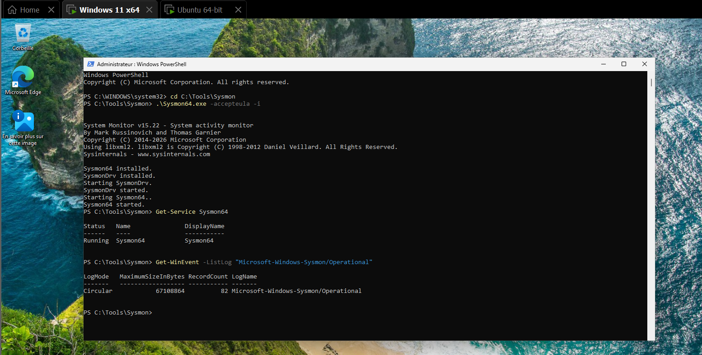
2. **Intégration Windows** — politique d'agent Elastic et intégration Windows. 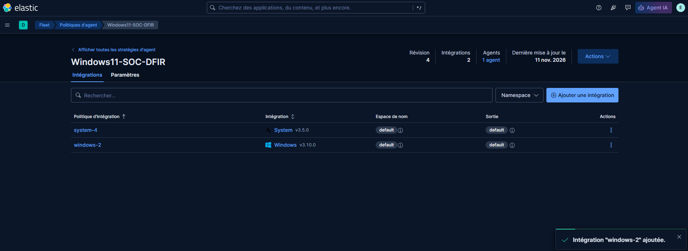
3. **Télémétrie Sysmon** — recherche de créations de processus Event ID 1 dans Elastic. 
4. **Détection** — alerte et événement PowerShell dans Elastic. 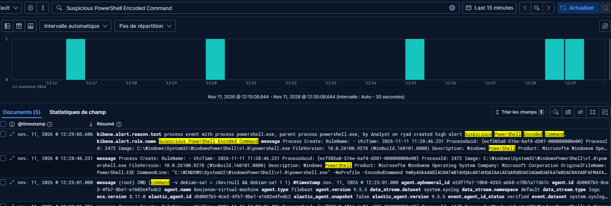
5. **KAPE** — résultat de la collecte ciblée et déduplication. 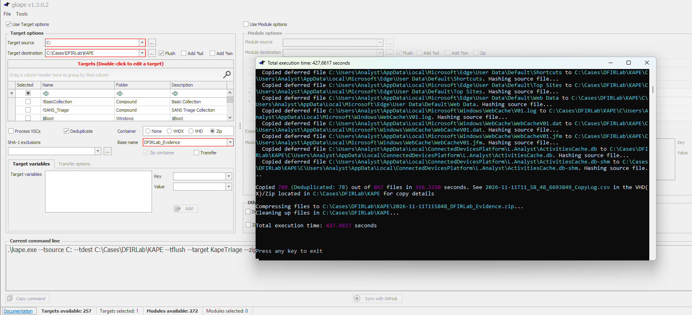
6. **Prefetch** — extrait PECmd : nombre et dernière heure d'exécution rapportés pour PowerShell ; le nom du fichier n'est pas visible dans cet extrait. 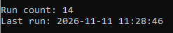
7. **Registre** — sous-clé créée pour le lab et valeur par défaut. 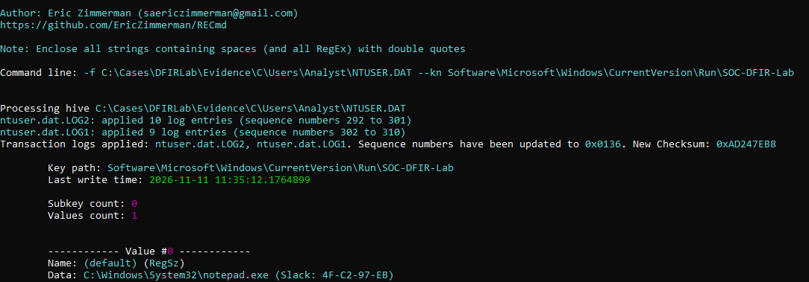
8. **FTK Imager** — visualisation des données collectées et de `NTUSER.DAT`. 
9. **Mémoire** — extrait Volatility montrant le processus PowerShell ultérieur. 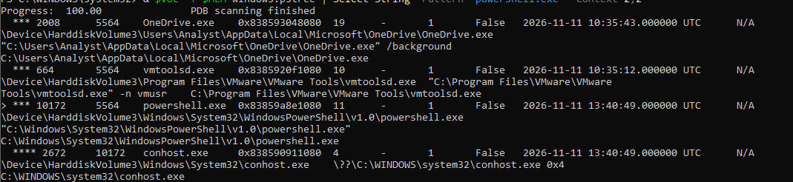
10. **TheHive** — création de l'organisation active. 
11. **Dossier initial** — case #1 et quatre tâches créées, avant ajout des observables. 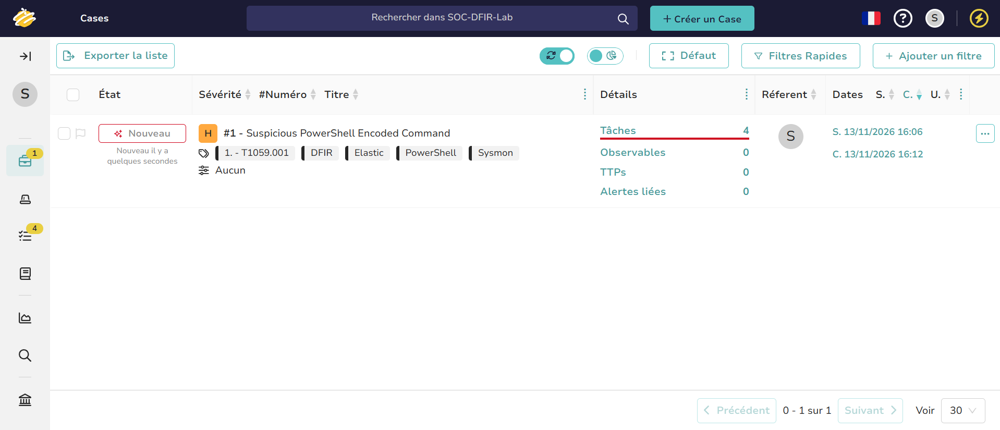
12. **Observables** — hôte, IP du laboratoire et empreinte SHA-256 documentés. 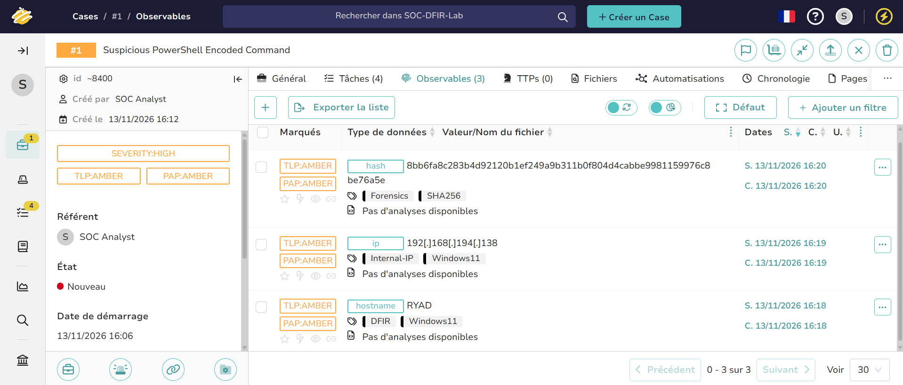
13. **Investigation** — quatre tâches terminées. 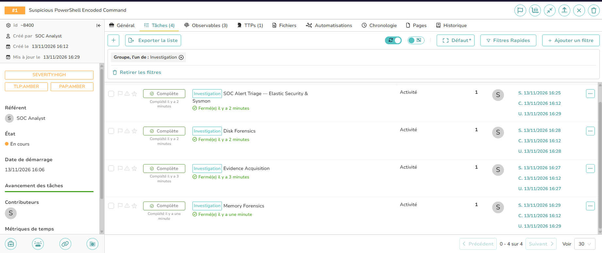
14. **Clôture** — vrai positif, sans impact, et résumé de l’investigation simulée. 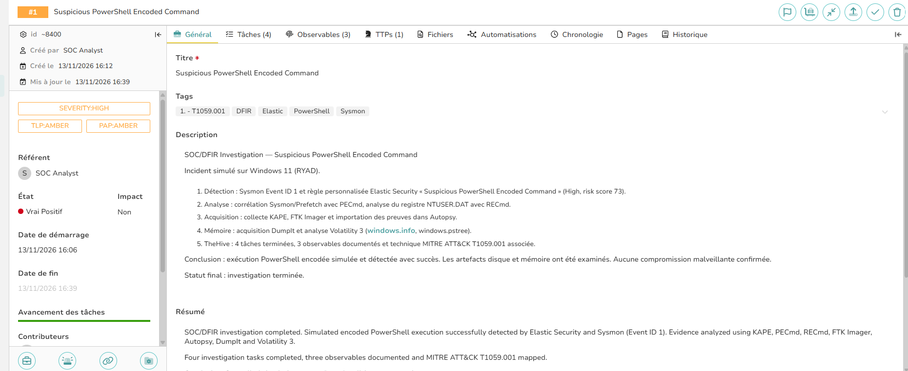

## Limites et recommandations

- Les captures et constats concernent une simulation isolée. Aucune compromission, persistance effective ou activité malveillante réelle n'est déduite de ces observations.
- Les horodatages de l'extrait Prefetch reposent sur le contexte communiqué ; le fuseau du registre reste à confirmer. Le PID mémoire ultérieur ne prouve pas la présence du processus initial lors de la capture.
- Le dépôt ne contient ni dump mémoire, ni données collectées, ni export complet de règle, ni hash d'intégrité ou chaîne de conservation documentée. La recherche par mots-clés Autopsy n'a pas abouti.
- Pour poursuivre : valider le contexte et les fuseaux des artefacts, documenter les méthodes de vérification d'intégrité lors des prochaines acquisitions, affiner les critères de détection et traiter les faux positifs. Poursuivre l’amélioration de la documentation et des procédures de réponse à incident.

## Auteur

Ryad Boujenan — [Portfolio](https://ryad-cyber.github.io/#p-dfir-windows) · [GitHub](https://github.com/Ryad-Cyber)
